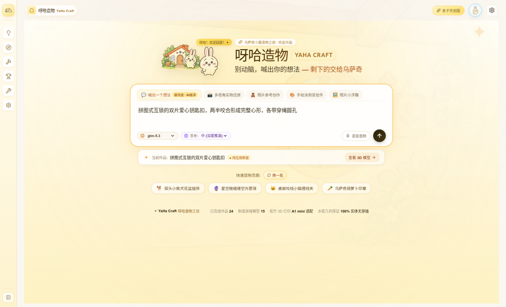
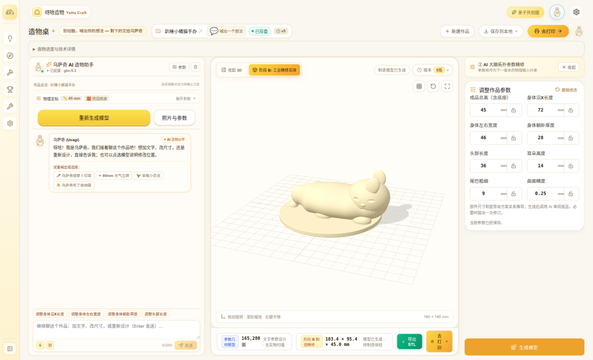
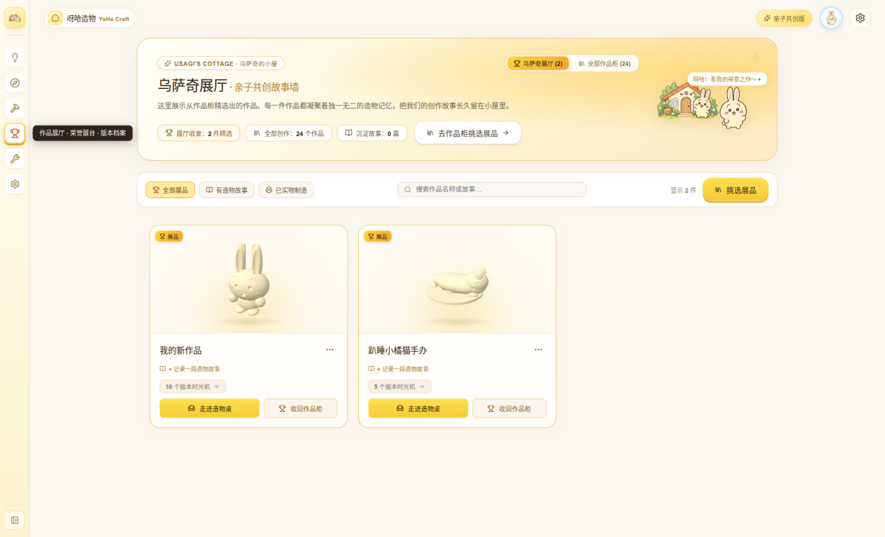
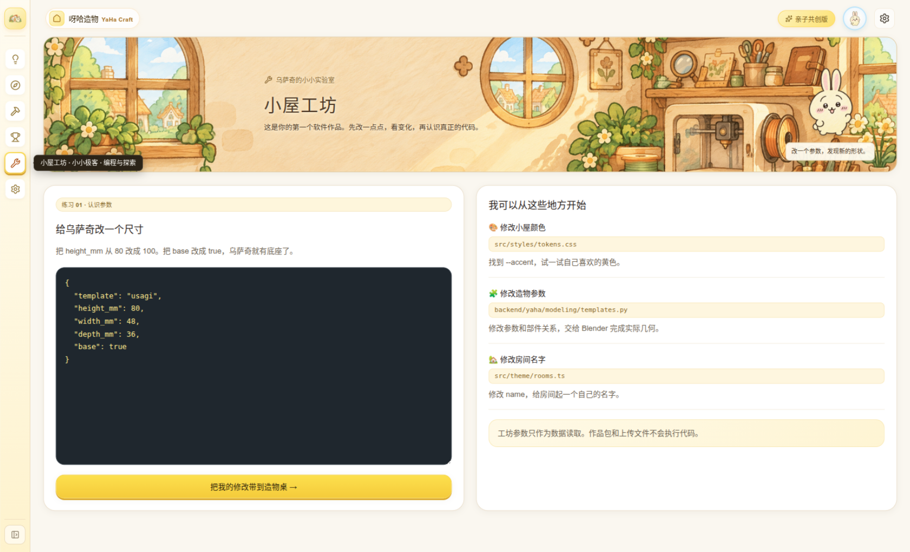
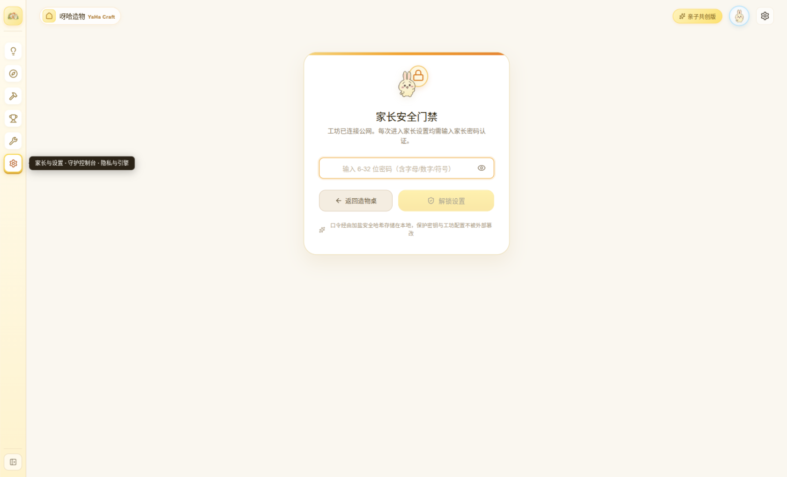

<div align="center">


# YaHa Craft · 呀哈造物

**Don't think too hard — shout your idea, and leave the rest to Usagi 🐰**

A Usagi-themed 3D crafting workbench for kids (around 12) and parents to create together:\
say an idea in plain words, snap a photo, or doodle something — AI plans the parameters, Blender builds a real watertight model, and Bambu Studio does real slicing, straight to a Bambu Lab A1 mini printer.

[](https://github.com/SourceAstra/HopMio/releases)
[](LICENSE)
[](NOTICE.md)


**[中文](README.md)** · [Design Spec (中文)](docs/呀哈造物系统详细设计规范.md) · [Contributing](CONTRIBUTING.md) · [Security](SECURITY.md)



</div>

> ℹ️ **Language note** — the app UI, docs and tests are written in Chinese; this English README is a guide, not a full translation. The product name 呀哈造物 is pronounced “yā hā zào wù”.

## ✨ What it does

A kid describes an idea in plain language (“a round pen holder, 100 mm tall, 3 mm walls”), uploads reference photos, or scribbles a doodle. YaHa Craft then:

1. **Understands the idea** — the LLM turns free chat into a structured design proposal, marking its assumptions for confirmation.
2. **Plans the blueprint** — structured geometry parameters are extracted; explicit engravings and holes must become real tool steps (true font extrusion, cylinder subtraction), never just notes.
3. **Fine-tunes together** — sliders in the right panel, or natural-language patches scoped to a selected part (“make the ears bigger”).
4. **Builds locally** — a trusted Blender pipeline produces the physical solid: real text engraving, arcs and fillets, millimeter-scale dimensions, manifold and watertight.
5. **Reviews the result** — rendered previews go back to a vision model for a design review; anything that fails stays a draft.

Two modeling paths are supported: **LLM parameter planning → Blender fabrication**, and **overlapping photos → COLMAP/OpenMVS surface reconstruction → Blender manufacturing copy**.

**Honesty guarantee**: AI-returned scripts are never executed (AI outputs structured parameters only); all slicing data comes from real Bambu Studio CLI receipts — no front-end estimates are shown as facts.

## 📸 Screenshots

| Three-column workbench: live 3D + AI chat + parameters | Usagi gallery: family story wall |
| :---: | :---: |
|  |  |

| Cottage workshop: a kid's first code entry | Print station: real A1 mini slicing & cloud print |
| :---: | :---: |
|  |  |

Parental console is protected by a separate gate (AI keys and device operations live behind it):



## 🚀 Getting started

### Windows installer (for users)

Download `YaHa-Craft-Setup-<version>-x64.exe` from [GitHub Releases](https://github.com/SourceAstra/HopMio/releases) and run the wizard. The bundle ships the web app, desktop entry, Python and engine dependencies — no Node.js, Go or system Python required. Works on Windows 10/11 x64; uninstalling keeps your projects in `%LOCALAPPDATA%\YaHaCraft\data`.

Blender, OpenMVS and Bambu Studio install as standalone tools (existing installs are auto-detected) via `resources\tools\安装建模工具.cmd` inside the install directory. AI endpoints and keys are configured by the user in the in-app Parent Settings.

### From source (for developers)

Requires Node.js 24+, pnpm, Python 3.12 x64, Go, and Blender 4.5 LTS (Blender ships its own Python; no `bpy` needed in the venv).

```bash
python3.12 -m venv .venv
.venv/bin/python -m pip install -r backend/requirements-lock.txt
pnpm install --frozen-lockfile
./setup.sh              # installs Blender / OpenMVS / Bambu Studio
./deploy.sh --foreground
```

Then open `http://127.0.0.1:5173`. On Windows use `安装建模工具.cmd` and `启动YaHa.cmd` instead (see the [Chinese README](README.md) for full details, packaging and release scripts).

### Checks and tests

```bash
pnpm build                                                        # TS typecheck + web build
PYTHONPATH=backend .venv/bin/python -m pytest tests/engine -q     # engine tests
node --experimental-strip-types --test tests/ui/*.mjs             # frontend contract tests
```

## 🤖 AI configuration

Open *Parent Settings* in the app to configure models — no default password is preset. You can keep multiple providers and switch anytime:

- **Model discovery**: enter an HTTPS base URL + API key to list available models, or add model IDs manually; OpenAI-compatible `/chat/completions` and Anthropic-style `/messages` endpoints both work.
- **Capability tests**: per-candidate “test text” and “test vision” probes (the vision test sends a built-in image to verify recognition).
- **Budgets & waiting**: per-model context window, max input/output tokens, timeout and reasoning effort.
- **Startup presets** in [config/models.yaml](config/models.yaml); keys are injected via environment variables and stored in the OS credential store — never in source or logs.

GLM (Zhipu, multimodal) and DeepSeek ship as default candidates. Photo-based refinement and post-generation design review require a vision-capable model; text-only models still work for parameter planning.

## 🧱 Architecture

**Frontend** React 19 + Three.js (hardware-accelerated viewport) · **Desktop** Electron · **Host** Go · **Engine** Python 3.12 · **Geometry** Blender 4.5 LTS · **Reconstruction** COLMAP / OpenMVS · **Slicing** Bambu Studio CLI

| Directory | Responsibility |
| --- | --- |
| `src/pages`, `src/features` | Rooms, proposal confirmation, parameters, versions, printing UI |
| `src/components`, `src/theme` | Shared components, Usagi theme, previews |
| `desktop`, `shared` | Electron process bridge & public capability manifest |
| `cmd/server`, `core-go` | Go host service (can run without Node.js) |
| `backend/yaha/modeling` | Plan contracts, parameter compilation, intent checks, design review |
| `backend/yaha/reconstruction` | Photo observations, camera solving, surfaces & textures |
| `backend/yaha/slicing` | A1 mini slicing and real-result checks |
| `backend/yaha/blender` | Trusted tools executed inside Blender |
| `backend/yaha/ai` | Model registry and JSON protocol adapters |
| `backend/yaha/storage` | SQLite, immutable revisions, controlled assets |

Every generation produces an **immutable version snapshot** (`.blend` / `.stl` / `.3mf` / `.glb`, plus the `.usagi` project bundle) with lossless rollback and diffing.

## 🤝 Contributing

Code, idea prompts, UI copy, model templates and tutorials are all welcome! Read [CONTRIBUTING.md](CONTRIBUTING.md) first (environment, test commands, and the Usagi-theme conventions). Note the UI and docs are Chinese-first.

## 📄 License

- **Code & docs**: [MIT License](LICENSE)
- **Art assets** (`public/art/usagi`, `docs/images`): [CC BY-NC 4.0](https://creativecommons.org/licenses/by-nc/4.0/deed.en) — see [NOTICE.md](NOTICE.md)

> ⚠️ The “Usagi” character closely resembles Usagi from *Chiikawa*; the assets are AI-generated non-commercial fan art. Please assess character-IP risk, or swap in an original mascot, before any commercial distribution.
