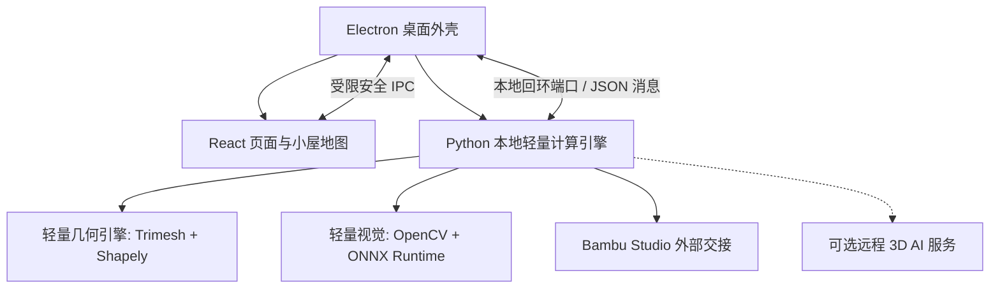

# 乌萨奇神奇小屋造物之旅：自然语言与照片 3D 造物工作台最终设计方案

**版本：** 6.2（单色 A1 mini 制造与工程落地增强版）  
**日期：** 2026 年 10 月 11 日  
**目标：** 以“乌萨奇小屋”为整个产品的主题空间与陪伴向导，建立可持续扩展的通用 3D 造物工作台。针对拓竹 A1 mini（单色版，180×180×180 mm 打印体积）及其同类 FDM 设备，打通“收集灵感 → 整理材料 → 确认想法 → 造物 → 模型体检 → 打印准备 → 打印 → 展示”全链路。产品面向 12 岁少年及其家庭，兼顾趣味创造与真实工程制造，孩子以后可以在此基础上自主编程扩展。

## 1. 总体决定

**从第一轮建设坚固平台骨架，核心模式真实闭环，高阶 AI 接口解耦。** 项目、生成模式、AI 提供方、几何编辑、打印检查、切片器、打印机和页面都在同一架构中拥有明确位置。第一轮交付可安装的 Windows 桌面程序，重点跑通单色杀手级模式（剪影、透光浮雕、带公差参数化功能件），并为重型 AI 模式提供规范的接口契约与实验样例。

**开发语言与轻量化策略：** 
- **客户端外壳：** Electron 负责 Windows 桌面集成、进程看护与本地文件安全桥接。
- **界面交互：** TypeScript + React 负责全部小屋房间、3D 模型预览及设计系统。
- **计算核心：** Python 承担图像预处理、几何生成、体检验证及切片交接。
- **计算轻重分离：** 轮廓、浮雕、透光画、网格修复等轻量计算采用纯本地（OpenCV + Trimesh + ONNX CPU）运行，安装包保持在 300MB 级别；高显存消耗的单图/多图 3D 大模型采用插件式服务接口接入，防止本地环境膨胀卡死家庭电脑。

**产品与制造原则：** 
1. **规格约束制造：** AI 负责意图理解与候选几何，结构化规格（DesignSpec）负责固化物理尺寸与公差，几何引擎负责生成严格封闭的水密实体。
2. **面向 FDM 制造优化：** 针对单色熔融沉积（FDM）特性，系统内置装配公差引擎、受力朝向优化、180mm 超限分切及单色光影视觉增强。
3. **双轨切片协同：** 保证“一键调起 Bambu Studio 打开 3MF”作为 100% 可用的黄金路径；同时提供局域网状态监控作为进阶极客能力。

**主题与版权原则：** “乌萨奇小屋”是产品的默认空间、语言和创作故事；乌萨奇作为向导提供温柔且准确的操作陪伴。系统采用**核心逻辑与主题皮肤分离**的架构，底层数据对象使用中立工程标识，乌萨奇形象采用独立主题包形式载入，确保未来开源分享或作品展示时合法合规。

## 2. 产品范围和扩展目标

### 2.1 服务对象

- **少年与家庭日常造物：** 制作宠物照片冰箱贴、光影透光小夜灯、背包姓名牌、礼物和手办摆件。
- **实用功能件创作者：** 用自然语言制作电池收纳盒、笔筒、手机支架、书签卡扣；内置装配公差保证实物能完美扣合。
- **单色 A1 mini 用户：** 针对 180mm 悬臂结构，获得超限分切、底面附着、受力摆放提示，发挥高精度单色打印的最大潜能。

### 2.2 模式矩阵（专为单色制造优化）

| 小屋里的模式名称 | 核心处理 | 单色交付形态 | 必须说明的制造边界与特性 |
|---|---|---|---|
| 文字造物（参数化模型） | 意图解析、模板参数化、装配公差补偿（Tolerance Engine） | 可编辑的盒子、挂钩、笔筒、支架 | 内置滑动/紧固间隙，保证盖子能盖上、孔洞能插合 |
| 照片剪影（单图轮廓） | 主体分割、轮廓矢量化、台阶拉伸、挂孔与倒角 | 钥匙扣、立牌、影子书签 | 单色依靠台阶高度差与边缘倒角制造光影立体感 |
| 光影浮雕（透光与浮雕） | 灰度-厚度反向映射（Lithophane）、层次浅浮雕 | 透光小夜灯片、冰箱贴、纪念牌 | 透光画需白色/半透明耗材背光显影；支持第 N 层手动暂停换色（M601） |
| 模型改造（导入已有模型） | 网格修复、尺寸测量、**180mm 超限分切**、摆放朝向 | 修复后可打印模型、拼接分件 | 超过 180mm 自动加榫卯对齐孔；提示受力件横放打印 |
| 单图想象（创意立体补全） | 图像生成候选 3D 网格、平底封闭、打印体检 | 创意立体摆件 | 背面为算法推测；采用服务接口接入，第一轮作为实验模式 |
| 多角度立体（多图重建） | 拍摄引导、位姿计算、稀疏点云、网格封闭化 | 真实物体立体手办 | 需多视角覆盖与实测尺寸；采用独立服务接入，标明实验状态 |

第一轮重点打通**文字造物、照片剪影、光影浮雕、模型改造**四大通用单色模式；单图与多图大模型采用稳定接口提供代表性样例，不阻塞安装包发布。

### 2.3 “小屋造物之旅”的完整任务链

1. **小屋门厅（收集灵感）：** 选择模式，或打开近期未完成的造物草稿。
2. **取材角（整理材料）：** 上传照片或模型；检查清晰度、主体完整性；输入关键毫米尺寸（如“高度 80mm”）。
3. **心意卡（确认想法）：** 确认主体用途、实测尺寸与装配配合度，区分“已确定／待确认／系统假设”。
4. **造物桌（开始造物）：** 生成带物理参数的 3D 实体；支持在 3D 视图中点选部件、拉伸厚度、添加挂孔，并可切换**“模拟真实 FDM 塑料层纹”**渲染质感。
5. **模型体检室（模型体检）：** 进行水密性硬检查、180mm 尺寸超限检测、悬垂支撑评估与**受力方向检查**；超限时提供一键切分。
6. **打印准备台（准备与切片）：** 选择 A1 mini 预设（0.4mm 喷嘴、0.2mm 层高）；计算预计耗材与时间；提供**“手动换色暂停层高提示”**；一键导出或直通切片。
7. **打印站（家长确认与发送）：** 显示操作安全须知；支持“一键在 Bambu Studio 中打开”或通过局域网连接监视设备状态。
8. **乌萨奇展厅（作品入屋）：** 把完成的模型摆上虚拟 3D 展台，记录创作故事，随时可返回造物桌重新修改。

## 3. 平台框架与核心数据契约

### 3.1 进程与模块边界



- **Electron 主进程：** 单一可执行程序分发、安全环境沙箱、看护 Python 引擎自愈重启。
- **React 渲染进程：** 纯前端渲染 UI 与 Three.js 3D 视口，无直接系统文件权限，保证系统安全。
- **Python 核心引擎：** 运行在本地独立后台，不捆绑笨重 CUDA/PyTorch，依赖控制在极简纯 CPU 轮子，确保任何家庭普通电脑 10 秒内启动。

### 3.2 核心数据契约（DesignSpec 与 ToleranceSpec）

为保证自然语言生成的零件能真正拼合，`DesignSpec` 必须包含确定性的公差与制造参数：

| 对象 | 必备字段 | 制造含义 |
|---|---|---|
| **DesignSpec** | `intent`, `dimensions_mm`, `tolerance`, `wall_thickness_mm`, `features` | 规格唯一真实来源，物理尺寸不可被 AI 悄悄漂移 |
| **ToleranceSpec** | `clearance_loose: 0.3mm`, `clearance_tight: 0.15mm`, `hole_compensation: +0.2mm` | 针对 A1 mini FDM 热胀与挤出补偿的全局公差配置 |
| **PrintBoundary** | `max_x: 180`, `max_y: 180`, `max_z: 180`, `safe_margin: 5mm` | 严格限制在 A1 mini 安全热床打印范围（175×175×175mm 实际可用） |
| **LayerPauseHint** | `enabled`, `pause_at_layer`, `pause_at_height_mm`, `color_name` | 指导单色机在第 N 层手动暂停换色（如白底黑字） |

## 4. 几何引擎与单色制造算法

### 4.1 几何生成路径

1. **单色台阶剪影（Silhouette & Bevel）：**
   - 提取主体轮廓二值图并进行多边形简化。
   - 分层生成：外圈边框（高 3.6mm，带 0.6mm 倒角防止刮手）、主体底板（高 2.4mm）、内部线条凹槽（深 1.0mm）。
   - 自动生成钥匙扣挂孔（外径 6.0mm，内孔 3.2mm，壁厚保证强度）。

2. **光影透光画算法（Lithophane Engine）：**
   - 读取灰度图像并反转灰度（暗处深、亮处薄）。
   - 灰度值线性映射为 Z 轴实体厚度：`Thickness = MinThickness + (1.0 - Gray) * (MaxThickness - MinThickness)`。
   - 默认厚度区间设为 **0.8mm（最亮） ~ 2.8mm（最暗）**，外围自动包裹 3mm 边框与平整底座，确保立在桌上不会倾倒。

3. **参数化功能件与公差融合（CAD Parametric）：**
   - 针对收纳盒、卡扣、支架等通用几何，使用确定性几何布尔运算。
   - 凡涉及盖合与卡扣，外壳与内胆自动施加 `ToleranceSpec.clearance_loose`（0.3mm 间隙），保证打印后无需打磨即可顺畅开合。

4. **180mm 智能超限切分（Auto-Splitter）：**
   - 当模型任意轴向尺寸 > 175mm 时触发警告。
   - 提供沿最优平面一分为二的切刀工具，并在切分面上自动生成**凸凹定位销（Dowel Pin & Hole，间隙 0.2mm）**，打印后涂胶水即可严丝合缝拼接。

## 5. 可打印性体检与切片交接

### 5.1 模型体检室（三层体检）

1. **几何水密硬检查：**
   - 是否为流形封闭实体（Watertight/Manifold）。
   - 检查是否存在自相交三角面、法线翻转或孤立悬空噪点，自动执行水密修复。
2. **A1 mini 物理规则检查：**
   - **尺寸碰撞：** 是否超出 180×180×180 mm 边界。
   - **热床接触面积：** 首层接触面过小时（如球底摆件），自动提示增加“平底切面”或建议开启 Brim（防翘边群边）。
   - **受力朝向评估：** 识别细长受力件（如挂钩柄），若垂直于热床（Z 轴受拉），发出警告并提供“一键放倒在热床（XY 平面）”优化强度。
3. **切片细节与换层提示：**
   - 检查薄壁是否小于 0.8mm（两圈喷嘴宽度）。
   - 若模型设计为双层浮雕，体检报告给出明确提示：“建议在切片软件中第 12 层（2.4mm 处）添加暂停换料”。

### 5.2 交付文件与 Bambu Studio 协同（双轨策略）

| 文件格式 | 用途 | 约束与细节 |
|---|---|---|
| **工程源文件 (`.usagi`)** | 小屋专属项目格式 | 包含原图、DesignSpec、版本历史、公差设置 |
| **标准制造级 `.3mf`** | 交接切片的核心载体 | 单色封闭实体，嵌入毫米单位与推荐摆放姿态 |
| **通用 `.stl`** | 传统三维模型导出 | 仅包含单色几何网格，用于第三方软件查看 |
| **预览 `.glb`** | React 页面流畅显示 | 轻量网格，带亚光 FDM 层纹着色器效果 |

**黄金协同路径（100% 稳定交付）：**
工作台完成设计后，点击“在 Bambu Studio 中打开”，主进程直接调用系统关联程序唤醒官方 Bambu Studio，并自动加载已预设好朝向与尺寸的 3MF 文件。用户可以在最熟悉的官方切片软件中点击切片并一键发送。这彻底避免了因官方固件或私有云协议更新导致的软件失效。

## 6. 设备连接与打印站（单色 A1 mini 适配）

### 6.1 设备抽象模型

设备适配器精简掉 AMS 多色槽位复杂度，聚焦于 A1 mini 单色机的核心状态：
- **设备静态属性：** 机型（Bambu A1 mini）、固件版本、喷嘴口径（0.4mm 默认）、最大打印尺寸（180mm）。
- **设备动态状态：** 连接状态、热床温度（目标/当前）、喷嘴温度（目标/当前）、当前打印任务名称、进度百分比、剩余分钟数、缺料与错误警告。

### 6.2 局域网模式配对向导（进阶极客路径）

打印站内置图文配对向导，引导孩子完成设备绑定：
1. **第一步：** 提示孩子在 A1 mini 实体屏幕上点击 `设置 → WLAN → 开启局域网模式`。
2. **第二步：** 在输入框中输入打印机屏幕显示的 **8 位局域网访问码（Access Code）** 与 **设备序列号（SN）**。
3. **第三步：** 本地 Python 引擎通过安全 MQTT (TLS 8883) 订阅设备事件，并在页面上以生动的仪表盘形式显示喷嘴温度和进度。
4. **安全保护：** 孩子模式下，实际发起打印动作必须由家长输入专属密码或二次确认，防止孩子误触误烫。

## 7. 乌萨奇小屋的主题设计与房间页面

### 7.1 视觉风格与房间隐喻

整套界面采用充满治愈感与创造力的绘本风格：奶油白基底、阳光暖黄强调色、柔和圆角卡片、低饱和度功能色。乌萨奇在左上角或角落作为小屋的智慧向导，用简洁温暖的语言提供下一步指引，杜绝枯燥冷冰冰的工业软件术语。

### 7.2 房间页面与功能对应

| 房间名 | 角色与主任务 | 核心按钮与单色制造特色 |
|---|---|---|
| **小屋门厅** | 欢迎、近期作品、模式选择 | “制作新物件”“继续上次的草稿”；展现 4 种核心单色模式与 2 种实验模式 |
| **取材角** | 输入照片或模型、尺寸标注 | “上传照片”“设定真实尺寸”；支持自动主体抠图与灰度透光预览 |
| **心意卡** | 确认想法与功能用途 | “设为松配合（盒子）”“设为坚固件”；让孩子感知公差的概念 |
| **造物桌** | 3D 几何预览与局部微调 | “调整厚度”“加上挂绳孔”“切换打印层纹质感”；直观看到 3D 造型 |
| **模型体检室** | 尺寸、流形、受力检查 | “一键放倒打印”“超限切分为两半”“查看换色层高” |
| **打印准备台** | 耗材估算、切片交接 | “在 Bambu Studio 中打开”“导出 3MF 文件”；清晰标明打印时间与米数 |
| **打印站** | A1 mini 状态大仪表盘 | “连接我的打印机”“请家长确认”；温度曲线与实时进度条 |
| **乌萨奇展厅** | 成果展示与故事陈列 | “摆上展台”“欣赏我的创造”；360 度旋转展台与创作经历卡 |
| **小屋工坊** | 孩子学编程与改软件的乐园 | “调整一个模板的 Python 脚本”“换一套房间配色”；实时热重载生效 |
| **作品柜** | 私人文件库与历史版本 | 搜索、导出、历史版本一键回滚 |

## 8. 安全、可靠性与儿童保护

- **100% 物理安全护航：** 3D 打印喷嘴温度高达 220°C，热床高达 65°C。软件在进入打印前，强制弹出醒目且通俗的安全提示：“打印机正在升温，请勿将手伸入打印区域，请在家长看护下操作”。
- **本地优先与数据私密：** 孩子的家庭照片、宠物照片默认完全在本地处理，绝不自动上传云端；家长设置面板中可一键关闭所有外部联网接口。
- **项目原子写入防损坏：** 保存项目文件使用临时写入后重命名机制，即使突然断电或程序闪退，也不会损坏已有设计。

## 9. 小屋工坊：为 12 岁少年定制的编程进阶路径

为了让孩子真正“能继续开发它”，不能让孩子陷入复杂的 TypeScript 类型编译或 Electron 调试地狱。系统设立**“低代码模板沙盒（Template Sandbox）”**：

1. **单文件模板驱动：** 每个参数化造物模型都是一个独立的 Python 小脚本（存放在 `templates/` 目录，如 `pencil_box.py`），核心代码只有 30~50 行。
2. **可视化参数映射：** 脚本头部用简单的注释声明参数：
   ```python
   # @param box_width: 宽度(mm) = 60, min=30, max=150
   # @param wall_thickness: 壁厚(mm) = 2.0, min=1.2, max=4.0
   ```
   页面根据注释自动生成调节滑块！
3. **即时热反馈（Live Reload）：** 孩子在内置的轻量工坊编辑器里修改一行数学公式，点击保存，右侧 3D 预览视口立即刷新变形。这种“改代码立即看到 3D 玩具变样”的即时反馈，是激发少年编程兴趣的最佳引擎。

## 10. 迭代建设顺序（落地路线图）

### 第一阶段（v1.0 坚固核心）：单色造物与打印闭环
- 交付 Electron + React 桌面程序外壳及小屋地图导航。
- 完整打通三大单色核心模式：
  1. **照片剪影**：照片背景分割 → 矢量轮廓 → 自动打孔 → 钥匙扣导出。
  2. **光影透光画**：照片灰度映射 → 实体小夜灯片生成。
  3. **参数化收纳盒**：内置公差补偿，打印实物盖子能顺畅合上。
- 实现模型水密检查与 180mm 尺寸超限提示。
- 交付“一键在 Bambu Studio 中打开 3MF”的黄金路径，使用真实 A1 mini 成功打印出实物。
- 乌萨奇展厅陈列第一个打印成果。

### 第二阶段（v2.0 工艺进阶）：极客制造与多模式扩充
- 增加 180mm 超限智能切分榫卯工具。
- 增加双色层高计算器（M601 换料提示）。
- 实现 A1 mini 局域网 MQTT 温度与进度仪表盘监视。
- 开放小屋工坊：允许孩子编写自己的 Python 造物小模板。

### 第三阶段（v3.0 实验性 AI 扩展）：接入前沿生成大模型
- 在保证本地轻量的原则下，以可选插件/云端 API 形式接入单图 3D 生成与多图重建实验功能。

## 11. 验收测试清单

1. **公差配合实测：** 使用文字造物生成一个 50×50mm 盒盖，在 A1 mini 上打印，要求无需打磨即可顺畅扣合且不松旷脱落。
2. **单色视觉实测：** 使用光影透光画模式生成一张宠物照片透光片，打印并在背光灯下拍照，图像明暗层次分明。
3. **超限保护实测：** 导入一个 200mm 的长直尺模型，体检室准确报警“超出 180mm 限制”，并能成功切分为带连接销的两半。
4. **协同稳定性实测：** 点击“在 Bambu Studio 中打开”，能无缝唤醒官方切片软件，且模型尺寸、朝向和实体完整性 100% 正确。
5. **少儿编程实测：** 孩子跟随工坊示例，在 5 分钟内修改一个模板参数（如把圆形挂孔改成心形），并成功在 3D 视口中看到变化。

---
*本设计方案立足于 12 岁少年的创造热情，紧密围绕单色拓竹 A1 mini 的物理现实，兼顾系统架构的前瞻性与工程落地的可行性，为孩子筑造一个真正能打印出生活奇迹的数字工坊。*
