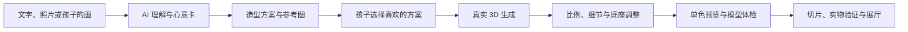
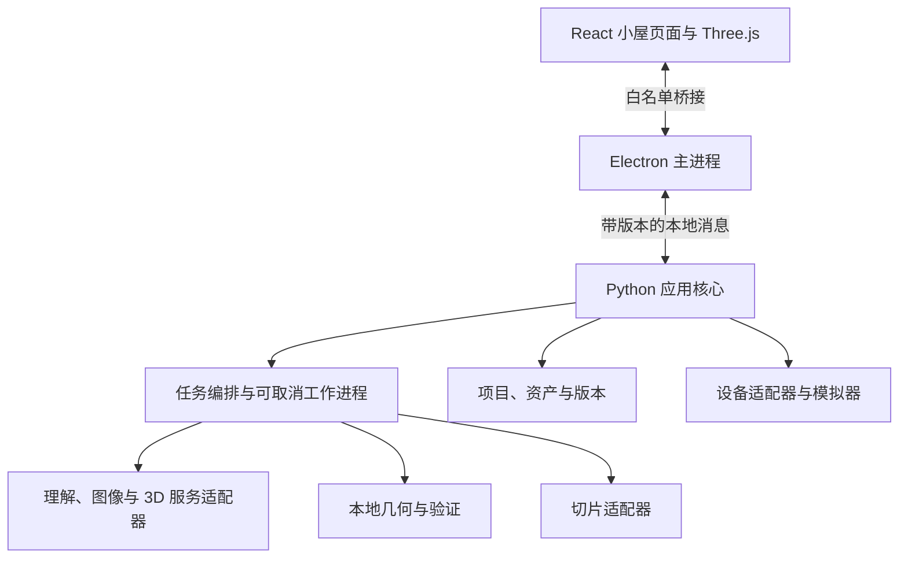

# 呀哈造物（YaHa Craft）工作台 · 乌萨奇小屋造物之旅

**亲子共创的第一款自然语言与照片 3D 造物软件：最终设计方案**  
**版本：** 7.5（乌萨奇主题实装修订版）  
**日期：** 2026 年 10 月 11 日  
**品牌定义：** 中文品牌名为**呀哈造物**，英文品牌名为 **YaHa Craft**。本项目为呀哈造物面向 12 岁少年与家庭的首款 3D 打印创造力工作台，以“乌萨奇小屋造物之旅”为核心世界观与主题体验。系统全面采用亲切的**全简体中文界面**与儿童友好的交互语言。  
**造物工作台标语：** “别动脑，喊出你的想法--- 剩下的交给乌萨奇”  
**目标：** 以“乌萨奇小屋”为主题打造“小屋造物之旅”，让小屋空间与乌萨奇陪伴向导贯穿整个产品，建立可持续扩展的通用 3D 造物工作台。针对拓竹 A1 mini（单色版，180×180×180 mm 打印体积）及其同类 FDM 设备，打通“收集灵感 → 整理材料 → 确认想法 → 造物 → 模型体检 → 打印准备 → 打印 → 展示”全链路。产品面向 12 岁少年及其家庭，兼顾趣味创造与真实工程制造。

**共创愿景：** 你和孩子一起设计一款真正可用、可以继续开发的软件，作为他的第一个软件作品。孩子能用描述、照片或自己的画生成作品，修改它，打印它，并向别人讲清楚“我设计了什么、为什么这样做”。

### 乌萨奇主题实装约定（软件 0.1.1）

以产品实际使用的 `public/art/usagi/companion.png`、`public/art/usagi/cottage.png` 和下述角色特征为角色与小屋的视觉依据。所有房间统一采用奶油黄色、大头短身、细长粉色内耳、亮黑圆眼、弯眉、ω 形嘴和脸颊刻线的乌萨奇，不用通用小兔代替。插画入口为 `src/theme/usagi.ts`，共享角色与小屋素材放在 `public/art/usagi`；新增页面继续复用这些组件。

默认模型使用独立的 `backend/yaha/geometry/usagi.py` 生成器，保留乌萨奇的轮廓和雕刻表情；单色模型依靠实际几何表达特征。旧内置示例新增主题版本，保留原版本与用户作品。设计草图和验收截图属于临时资料，不进入源码仓库。

## 1. 这份作品要带给孩子什么

这是孩子的第一款软件作品。成功既包括好看的模型和真实打印，也包括他的判断、设计与代码贡献：他能参与决定页面、模式和操作方式，能完成一项有实际效果的功能修改，并愿意继续为下一版提出想法。软件的作者介绍、版本故事与共创记录从第一轮进入产品。

**完整大框架从第一轮建立，真实 AI 从第一轮接入。** 所有房间、生成模式、项目格式、任务系统、版本、打印检查、切片交接、设备接口、主题与开发入口同时进入统一架构。第一轮必须跑通自然语言／照片到真实 AI 模型、可编辑预览、可打印文件和实物验证的链路。后续提升算法质量、设备覆盖与编辑深度。

**学习语言以 Python 为主；产品界面使用 TypeScript + React，桌面外壳使用 Electron。** Python 让孩子逐步接触参数、函数、图像和几何，React 让他能继续修改小屋页面。桌面集成、安装、设备协议和复杂算法由你协助。不同阶段有对应的学习入口，不要求孩子一开始掌握全部技术。

**软件既有创作自由，也有准确说明。** 乌萨奇陪伴他探索；系统明确区分“我的选择”“AI 的建议”“看不见部分的推测”和“已经实测的结果”。错误能恢复，修改能撤销，打印检查有具体依据。AI 可以帮忙解释、构思和生成，重要决定与最终选择由你们做。

## 2. 你们怎么一起设计

### 2.1 共同作者的分工

| 内容 | 孩子的主要参与 | 你的主要参与 | 在软件中留下的记录 |
|---|---|---|---|
| 软件名称、房间和向导 | 选择名字，画草图，改提示语，决定喜欢的样子 | 帮助把草图转为能操作的页面 | 小屋设计稿与命名记录 |
| 第一件代表作品 | 选择照片／画／用途，决定轮廓、比例与细节 | 解释尺寸、材料和打印条件 | 灵感图、心意卡、前后版本 |
| 功能设计 | 说出遇到的困难，提出一个改进，体验实现效果 | 帮助拆任务、实现接口和验证 | “这一版我改了什么” |
| 编程 | 修改一个参数、函数或页面功能，解释变化 | 搭环境、讲代码、协助找错和恢复 | 代码差异、预览与作者说明 |
| AI 结果选择 | 比较候选，指出不像或不喜欢的位置 | 解释生成限制、费用与数据传输 | 选择理由与修改记录 |
| 实物打印 | 看切片、观察结果、测量、提出改进 | 负责设备设置、热部件、换料与现场看护 | 打印照片、测量结果与下一版 |

每次共创围绕一个能看到结果的问题，例如“怎样让耳朵更结实”“怎样让第一次上传更清楚”。先让孩子表达与尝试，再一起解释和实现。一次共创可以只完成一处有意义的改变；当天保存可运行版本和一句创作记录，不以完成代码行数衡量进步。

AI 辅助开发也保留贡献记录：孩子提出和修改了什么，你协助了什么，哪些部分由工具生成。作品介绍由孩子用自己的话完成。首页、展厅和“关于这间小屋”呈现这段真实的共同创作过程。

### 2.2 首次展示的故事

第一轮完成后，你们可以打开安装好的软件，让孩子展示：进入小屋 → 输入自己的灵感 → 选择 AI 结果 → 修改一个细节 → 查看模型体检 → 打开切片软件 → 展示打印实物 → 回到展厅讲述过程。同时演示他修改的一项软件功能。这让第一件打印成果与第一款软件作品相互呼应。

代表作品由孩子选择。建议准备两条并行样例：一件有明显造型特色的 AI 摆件，一件有明确参数的姓名牌／收纳物件；两条样例共用完整框架，分别说明“创意生成”和“尺寸设计”怎样工作。

## 3. 第一轮 AI 怎样产生好看的模型

### 3.1 三种 AI 能力分别负责什么

| 能力 | 负责的事情 | 不应承担的保证 | 第一轮要求 |
|---|---|---|---|
| 多模态理解模型 | 听懂中文描述、理解照片、提出关键问题、生成结构化心意卡 | 不凭空保证尺寸、公差和承载能力 | 真实接入，规格输出经模式校验和用户确认 |
| 图像设计模型 | 根据文字或草图提出造型方案，生成可供选择的概念图 | 不把二维图片称为已完成的 3D 模型 | 首轮纳入真实适配器，用于文字创意摆件和风格探索 |
| 3D 生成模型 | 从选定图片、文字或多视图生成立体网格 | 不保证背面准确、部件语义完整或直接可打印 | 首轮接入至少一个真实服务，并完成实物验证 |

理解、图像设计和 3D 生成可以来自不同服务，通过统一的提供方接口调用。**首轮采用云端 API 运行重型生成，本地处理项目、预览、尺寸、几何编辑与打印检查。** 不把高显存模型强行捆进基础安装包；后续可增加本地模型适配器。使用云端生成前由家长配置服务、允许发送的内容和使用额度。

3D 服务参考实现选用 **Meshy API**，首轮覆盖文字、单图与多图生成路径。它提供相应的公开 API；是否适合你们想要的造型，仍用自己的样本与打印结果评估。上线时固定通过测试的模型标识，记录每次调用版本，不依赖会变化的默认 `latest`。这一选择是首个接入实现，扩展接口允许以后更换服务。[Meshy 快速接入](https://docs.meshy.ai/en/api/quick-start)、[多图生成接口](https://docs.meshy.ai/en/api/multi-image-to-3d)

### 3.2 从灵感到好看、再到可打印



用户输入原照片时，可以直接走单图 3D 生成，也可先做风格化参考图；输入文字时，可走文字 3D 或先选择概念图。界面说明当前路径和将发送的内容，按提供方的实际输入数量与格式引导选图，不能静默丢弃多余视图。先用少量二维方案确定造型，再生成选中的立体结果；继续生成由用户主动选择，不在后台无限尝试。

好看的模型来自一套创作过程：主体清楚的参考图、明确的比例与轮廓、适合单色打印的层次、孩子的选择和局部调整。预设风格可以包括圆润摆件、浅浮雕、剪影、低细节桌面装饰；避免默认生成过细的毛发、悬空配饰或脆弱长杆。AI 输出保留原始版本，缩放、加底座、加厚和分件另存版本。

### 3.3 单色打印的视觉真实性

造物桌提供“彩色创意预览”“单色实体预览”“切片预览”三种清楚标记的视图。**贴图上的颜色、阴影和眼睛不会自动成为单色打印的凹凸细节。** 孩子选择用于打印的作品时，重点看去掉贴图后的轮廓、体积和几何层次。需要保留的图案转成经过检查的浮雕／凹槽，或留作后期上色计划。

FDM 层纹渲染只作为外观示意；真实支撑、层线与细节以切片和打印为准。展厅可以同时放彩色概念模型、单色制造模型和实物照片，分别标注。不能用漂亮贴图代替打印质量验收。

### 3.4 对 AI 的可控修改

多模态模型将“耳朵加厚一点”转成修改建议。参数化部件可按明确参数执行；生成网格若缺少耳朵语义，先让孩子点选区域，再使用受支持的局部编辑。需要重新生成时说明会影响哪些部分并保留旧版。首轮可靠支持整体缩放、底座、挂孔、受约束加厚与分件；自由语义编辑按实际适配能力开放。

云端任务记录提供方任务标识、输入、参数、时间、结果、费用信息及本地输出。超时后先查询原任务；取消本地等待不等于服务取消或费用退回。额度不足、服务失败或断网时保留已有作品，可继续编辑与导出。

## 4. 六种造物模式与扩展空间

| 小屋里的名字 | 实际能力 | AI 与本地计算的分工 | 第一轮验收内容 |
|---|---|---|---|
| 文字造物 | 参数化功能件与文字创意摆件 | AI 判断用途；功能件用模板几何，摆件走真实 3D 生成 | 一个尺寸模型与一个创意模型，错误规格可纠正 |
| 照片剪影 | 遮罩、轮廓、拉伸、挂孔与底座 | AI／视觉算法分离主体；本地生成封闭几何 | 修遮罩、改尺寸、导出和实物样例 |
| 光影浮雕 | 浅浮雕与透光画两种子模式 | 视觉提取线条／灰度；本地映射几何厚度 | 两种子模式明确区分，背光效果实测 |
| 单图想象 | 从照片／画生成创意立体模型 | 真实图像到 3D 服务；本地编辑与制造检查 | 自己的输入真实生成，展示推测背面并打印 |
| 多角度立体 | 多图生成，后续可扩展摄影测量 | 首轮真实多图服务；摄影测量为独立适配器 | 同一对象多图生成与尺寸确认；不称为精确扫描 |
| 模型改造 | 导入、测量、修复、分件与摆放 | 本地网格处理，AI 给出可审阅建议 | 成功与失败模型、可撤销修复和切片交接 |

六种模式都从第一轮进入页面、接口、任务与版本系统，并有真实适配器和代表性样例。重型模式依赖外部服务时，明确显示“需家长配置服务”；演示素材不能被当成本次生成结果。参数化、创意网格和摄影测量保留各自输出能力，不把创意补全等同于物体的精确复刻。

## 5. 小屋造物之旅：同一套工作流

| 步骤 | 房间 | 孩子看到与决定的内容 | 系统保存的内容 |
|---|---|---|---|
| 收集灵感 | 默认主页／小屋门厅 | 在主页输入灵感、继续作品；进入门厅选择六种模式或示例 | 项目与生成模式 |
| 整理材料 | 取材角 | 上传照片／画／模型，修主体，补视角，填写真实尺寸 | 原资产、遮罩、质量提示和实测尺寸 |
| 确认想法 | 心意卡 | 主体、用途、风格、保留部分、尺寸；确认系统假设 | 结构化 DesignSpec 与确认记录 |
| 开始造物 | 造物桌 | 选择方案，生成、旋转、比较、改参数与部件 | 原始生成结果、场景部件和新版本 |
| 模型体检 | 模型体检室 | 点击问题定位，查看原因，对比修复 | 验证报告、配置与可撤销修复 |
| 打印准备 | 打印准备台 | 选机型材料，看首层、支撑、用料和时间 | 模型文件、切片配置及真实切片结果 |
| 家长确认与打印 | 打印站 | 查看设备与任务，家长现场确认 | 交接状态或设备回执，不能混为一谈 |
| 作品入屋 | 乌萨奇展厅 | 命名、摆放、写故事、放实物照片、继续修改 | 展陈布局、故事与实物记录 |

各步骤可保存、返回和跳转到已有成果。更改尺寸、材料或模型后，下游体检和切片结果标记失效并重新计算；页面不能继续使用旧的绿色通过标记。生成进度显示实际阶段，可取消，耗时较长时仍能查看其他作品。

## 6. 乌萨奇小屋的页面与视觉

### 6.1 适合 12 岁的活泼设计

乌萨奇小屋采用有创作感的房间地图、作品卡片、便签和小插画。奶油白基底、阳光黄主色、天空蓝／珊瑚橘辅助色、深色文字。布局清楚，有足够的模型操作空间；风格适合少年，避免把每个按钮写成幼儿口吻或把工具隐藏在装饰中。

房间地图与简洁列表导航都可使用，顶部持续显示当前位置和下一步。主要按钮用明确动作：“生成模型”“检查模型”“保存新版本”“导出 3MF”“在 Bambu Studio 中打开”。趣味名称用于房间和故事，尺寸、费用、风险与设备操作用准确说明。颜色提示同时配文字与图标，动画可关闭，键盘焦点可见。

造物桌支持“创作面板”和“进阶面板”切换，两者编辑同一项目。创作面板先显示尺寸、厚度、底座、主体修正与撤销；进阶面板展开部件、几何参数、日志与版本。由孩子选择自己需要看到的深度。

#### 界面效果图 1：已确认的默认主页——三栏造物桌

**主页采用下图。** 启动呀哈造物后默认进入这个可以立即开始创作的界面，左侧导航选中“造物桌（主页）”。这张图确定全站的奶油白与阳光黄配色、卡片圆角、插画分量、侧栏导航和按钮风格；其他房间沿用同一套视觉系统。


主页布局按图落实：顶部是产品与主题名称、项目名称、保存状态和简洁流程进度；左侧固定小屋房间导航，底部保留“去展厅看看”。主内容由“我的灵感”“3D 模型预览”“调整作品”三栏组成；底部固定“保存新版本”和“去模型体检”。右侧同时展示打印配置与版本，孩子能在同一屏找到输入、结果和下一步。

**首次打开：** 展示可旋转的示例模型，并明确标注“示例作品”；孩子输入描述、上传照片或打开自己的画后才创建项目，点击“生成模型”并满足家长设定的权限与额度后才调用真实服务。**再次打开：** 可以恢复上次草稿或新建作品；没有模型时保留输入区与造物引导，不虚构“已保存”、版本或打印检查结果。

页面顶部使用“呀哈造物”作为中文主品牌，“YaHa Craft”作为英文辅名，“乌萨奇小屋造物之旅”作为主题名称。造物桌标题旁展示完整标语“别动脑，喊出你的想法--- 剩下的交给乌萨奇”；空间较小时可以换行，不能省略后半句。厚度等参数根据当前模式解释为底板厚度、壁厚或局部厚度；不把示例图上的 3 mm 直接应用于所有摆件。流程导航继续覆盖取材、心意卡、体检、打印准备和展示，切换步骤保留项目。

#### 界面效果图 2：小屋门厅——六种造物模式选择页


保留小屋街景、乌萨奇向导与六张模式卡，作为从主页进入的模式选择页。门厅、进阶编辑与展厅配图是此前的布局参考，图内旧品牌文字在正式页面中统一替换为“呀哈造物（YaHa Craft）”。实际页面当前导航应选中“小屋门厅”，选定模式后进入对应取材与心意卡流程，再回到主页的造物桌完成创作。门厅可展示最近草稿与代表作品。

#### 界面效果图 3：造物桌——进阶编辑与制造预览参考


保留对话、彩色概念／单色实体／切片视图、部件参数与切片交接的交互思路。实际布局和组件使用已确认主页的侧栏、卡片与按钮样式；“在 Bambu Studio 中打开”属于打印准备步骤，模型体检与文件交接状态真实显示。

### 6.2 全部正式房间

| 房间 | 重点设计 |
|---|---|
| 造物桌（默认主页） | 采用已确认的三栏效果图；灵感输入、模型预览、调整参数、版本与下一步在同一屏 |
| 小屋门厅 | 从主页进入的六种模式选择页；新作品、最近草稿与代表作品，有“关于这间小屋”入口 |
| 取材角 | 上传区、主体画笔、拍摄引导与尺寸标记，随手画也能成为输入 |
| 心意卡 | 可编辑设计卡，明确区分我的选择、AI 建议和待确认项 |
| 模型体检室 | 模型问题位置、原因、修复前后对比与重新检查 |
| 打印准备台 | 打印配置、真实切片或等待交接的状态、文件导出 |
| 打印站 | 设备状态、家长确认、真实进度；模拟设备持续标注 |
| 作品柜 | 搜索、版本、文件和恢复，负责项目管理 |
| 乌萨奇展厅 | 旋转展台、作品墙、创作故事与软件成长记录 |
| 小屋工坊 | 改主题、模板与函数；预览、恢复、查看代码对应的结果 |
| 家长与设置 | 服务密钥、额度、联网权限、设备、备份、字号与减少动画 |

乌萨奇是贯穿全部房间的向导：进入房间时给一句提示，任务完成时回应，遇到错误时告诉孩子具体下一步。向导不遮挡模型、尺寸或风险，可隐藏。角色素材采用独立主题包，记录来源与使用范围；家庭提供素材与公开发布素材分别管理，公开发布时复核权限。主题更换不改变核心数据格式。

### 6.3 错误也要帮助孩子继续

提示包含“发生了什么、影响在哪里、下一步能做什么”。例如：“这张照片的耳朵被裁掉了，模型可能会猜它的形状。你可以补拍，或保留这次想象。”技术错误在可展开区域保留，主界面不用一屏异常堆栈吓退孩子。

尝试失败也能留下版本和笔记。没有强制签到、竞争榜或反复催促的奖励；成长记录来自真实的创作、修复和软件贡献。家长确认集中在云端、公开分享、设备与付费边界，日常改尺寸、保存和撤销顺畅完成。

## 7. 展厅：展示模型，也展示第一款软件

展厅包含三个可布置区域：**作品展台**放 3D 模型与实物照片，**造物故事墙**放灵感、选择和重要修改，**小屋成长墙**放页面草图、软件版本和孩子亲自实现的功能。

每件展品记录“我想做什么、我选了什么、哪里失败过、后来怎么改”。实际打印状态由设备回执或人工记录确定；人工补录标明来源。孩子可以给展品命名、摆放、选择背景，随时返回造物桌编辑。项目管理仍由作品柜承担，两处共享同一份版本数据。

“关于这间小屋”展示孩子和你的共同作者介绍、所用工具及帮助。首次发布导出一份作品包：应用安装包、可恢复源项目、代表模型、实物照片、共创说明和版本故事。公开分享默认移除家庭照片、密钥、访问码与私人路径；孩子决定哪些故事愿意分享，家长确认发布内容。

#### 界面效果图 4：乌萨奇展厅与亲子共创故事墙


保留木质展台、软木故事墙、灵感图、实物照片与作品档案。展厅共用主页的品牌和导航，场景内可使用暖木色。图中人物、奖章、彩色摆件与耗时为展示示意；实际作品可自由摆放，记录以真实生成、打印或人工补录为准。“返回造物桌”回到该作品在默认主页中的编辑状态。

## 8. 小屋工坊：让他真正继续开发

### 8.1 三层可接近的学习入口

| 层次 | 孩子能做的事 | 形成的实际能力 |
|---|---|---|
| 主题与内容 | 改房间颜色、提示语、卡片、展厅布局 | 认识界面、配置、可读文案和用户体验 |
| 模板与规则 | 改尺寸范围、增加部件选项、解释为什么要加厚 | 认识数据、约束、参数和验证 |
| Python 与页面函数 | 改几何函数、增加一种挂孔、实现一个页面操作 | 认识变量、条件、函数、输入输出和调试 |

前两层默认可预览并恢复；真实代码编辑由你们在开发模式中共同使用，附对应源文件入口。首轮就交付工坊、一个可理解的模板和一份短入门说明，不把学习功能延后。孩子不只改配色：至少有一项能改变模型或工作流行为的功能由他参与实现和解释。

### 8.2 可读代码与反馈

模板参数用明确的数据定义维护，包含名字、单位、默认值、范围与说明，自动生成界面控制。入门样例只展示一个核心函数及所需参数；复杂网格和接口封装在命名清楚的辅助函数里。示例契约可以是：

```python
# 设计中的入门接口示意；具体函数由几何模块实现。
def build(params, tools):
    return tools.nameplate(
        text=params["name"],
        width_mm=params["width_mm"],
        thickness_mm=params["thickness_mm"],
        hole_shape=params["hole_shape"],
    )
```

孩子先预测改一处会发生什么，再点击“运行预览”，比较新旧模型。错误保留行号与简短解释，能恢复上次可运行版本；预览计算与打印发送完全分开。需要时继续打开标准代码编辑器，学习入口始终对应真实仓库，避免只会操作一个封闭的教学玩具。

### 8.3 代码执行的真实边界

Python 子进程提供超时、取消和崩溃隔离，**它本身不构成能安全运行任意代码的沙箱**。基础创作模式只调用内置注册工具和参数，不执行照片、项目或 AI 返回的代码。开发模式运行的是你们已审阅的本地模板；导入项目只加载数据，不自动执行附带脚本。开放第三方插件市场之前另行落实操作系统级隔离与权限模型。

## 9. 完整架构与语言选型

### 9.1 技术组成

| 部分 | 选型 | 原因与边界 |
|---|---|---|
| 孩子主要学习与计算核心 | Python | 图像、几何、AI 适配与规则组织一致，入门函数可逐步理解 |
| 全部页面与主题 | TypeScript + React | 组件化房间、稳定类型、统一状态与主题；用入门示例降低复杂度 |
| 3D 视口 | Three.js | 预览、选区与风险位置显示；预览网格与制造网格分开 |
| 桌面外壳 | Electron | 本地文件、安装、启动 Python、看护任务与外部切片软件 |
| 图像处理 | OpenCV；分割提供方可替换 | 遮罩、轮廓、灰度与输入质量检查；模型依赖按需安装 |
| 网格与几何 | trimesh + Shapely，布尔运算接 Manifold 后端 | 轮廓、网格分析与实体操作；保留未来 CAD 生成器接口 |
| 项目与任务 | SQLite + 资产目录 + JSON Schema | 本地恢复、版本与共享契约，两端类型由契约生成 |
| 重型 AI | 云端 API 适配器 | 首轮真实生成，模型版本、费用与任务可追溯；可增加本地提供方 |
| 切片与设备 | 独立 Bambu Studio／设备适配器 | 切片、状态读取与实际启动分开验证 |

trimesh 的布尔运算依赖实际后端，需打包并验证对应依赖，不能仅安装网格库便假定所有实体运算可用。[官方布尔运算说明](https://trimesh.org/trimesh.boolean.html)

采用有明确模块边界的本地应用。框架分离页面、业务与算法；跨模块通过契约调用，不让页面直接操作模型生成、文件或打印协议。基础包与可选模型组件分开分发，安装体积、启动时间和内存目标根据你们的电脑实测后确定。

### 9.2 进程与任务



首轮桌面与 Python 采用标准输入输出上的 JSON 消息，带请求标识、协议版本、进度、错误码与取消指令；业务日志走独立通道。照片和网格传受控资产标识，不反复复制到消息里。工作进程限制并发、内存与时间；重启后从记录恢复任务状态或明确标记中断。

Electron 页面启用隔离与沙箱，不开放 Node.js 系统能力；主进程只暴露经过参数与路径校验的方法。密钥和设备访问码不进入页面、项目文件与日志。[Electron 隔离说明](https://www.electronjs.org/docs/latest/tutorial/context-isolation)、[进程沙箱](https://www.electronjs.org/docs/latest/tutorial/sandbox/)

### 9.3 扩展接口与能力注册

稳定接口包括输入处理器、理解／图像／3D 提供方、生成器、编辑操作、验证与修复规则、切片器、设备适配器、主题包。每项声明标识、接口版本、输入输出模式、依赖、资源需求、编辑范围、自检与已验证组合。

能力状态区分“可用”“需配置”“实验”“暂不可用”，显示具体原因。生成服务可用不代表结果可打印，结果体检状态单独存储。第一轮插件由应用明确注册和分发；新增能力要有真实样例与契约检查，不动态执行下载来的任意代码。

## 10. 项目、版本与文件契约

| 对象 | 必备信息 |
|---|---|
| Project | 标识、名称、源资产、当前版本、主题与本地作者设置 |
| DesignSpec | 用途、毫米尺寸、部件、风格、打印约束、确认项、系统假设 |
| Scene / Part | 几何资产、部件标识、坐标变换、参数、可编辑范围 |
| Revision | 父版本、变更原因、生成器和模型版本、输入哈希、随机参数（若提供） |
| PrintProfile | 机型、喷嘴、材料、打印板、工艺与校准结果 |
| ValidationReport | 问题位置、测量值、规则来源、配置、结论和修复建议 |
| Job / Artifact | 阶段、服务任务标识、费用记录、输入输出、错误与事件 |
| Story / Contribution | 设计选择、修改说明、实物记录和你们的贡献 |

统一使用毫米，坐标系、导出变换和网格精度明确约定；版本含模式迁移规则。AI 建议先通过规格校验，关键尺寸由用户确认。源数据和原始 AI 输出保留，新编辑形成独立版本。项目保存采用临时文件、原子替换与校验；恢复能力需要崩溃测试，不能承诺所有断电情形都无损。

`.usagi` 是应用自定义的项目包，包含模式版本、JSON 规格、照片、遮罩、几何与版本记录，不包含可自动执行代码或账号凭据。STL 是几何交换文件，不承载完整参数；通用模型 3MF 保存模型信息，Bambu Studio 项目和已切片文件分别标记；GLB 用于预览。导出摘要同时写明毫米尺寸和用途。[3MF 规范](https://3mf.io/spec/)

仓库按桌面、页面与主题、共享契约、Python 核心、适配器、模板、样例、检查和文档组织。入门文件有稳定位置与短说明；一条开发启动流程能打开页面和引擎，开发错误可定位。仓库版本与用户的模型版本分别管理。

## 11. A1 mini 单色制造与模型体检

### 11.1 尺寸、公差与真实配置

首个验证环境采用 A1 mini 单色配置；官方机型配置的打印区域为 180×180 mm、高度 180 mm。0.4 mm 喷嘴与 0.20 mm 工艺作为首个待验证组合，实际喷嘴、材料和切片预设以家中设备为准。[Bambu Studio 官方 A1 mini 配置](https://github.com/bambulab/BambuStudio/blob/master/resources/profiles/BBL/machine/Bambu%20Lab%20A1%20mini%200.4%20nozzle.json)

尺寸检查依据摆放后的几何、支撑、附着边和实际切片配置。预留边距是可调工艺策略，不把实际可用体积写死为 175³ mm；例如 XY 两侧各留 5 mm，会留下 170 mm 的相应宽度。先尝试合适摆放再提供分切建议，孩子能预览切面、连接结构和组装方式。

公差由“打印机＋材料＋方向＋特征”组合校准。0.15／0.3 mm 等只能作为校准试片的候选，需注明单侧或总间隙；不能保证任意盒盖、卡扣无需打磨。先打印孔销与盒盖试片，记录测量与装配结果，再应用于功能件。涉及载荷先确认用途、方向与实物测试，自动摆放只提供建议。

### 11.2 三层体检

1. **几何检查：** 单位、封闭性、法向、异常薄片、自交与孤立部件。不同检查器声明检测能力；网格封闭不等于结构可靠。
2. **工艺检查：** 打印空间、薄壁、细节、孔位、底面接触、悬垂、支撑与装配。阈值结合线宽、层高、材料和方向；没有测过的组合显示未评估。
3. **切片检查：** 首层、细节是否消失、支撑、实际路径、用料与预计时间。以真正的切片结果为准。

检查显示具体位置、原因和下一步。补洞、加厚、改底座或分切都保存独立版本；孩子确认前后变化，关键尺寸与外观不可被悄悄覆盖。严重几何问题阻止直接发送，仍可保存源项目和导出标明问题的检查资料。

### 11.3 浮雕、透光与单色细节

浅浮雕突出线条和层次；透光画按亮度映射厚度，二者有不同的预览和材料条件。厚度范围、框架与底座使用已测试模板，透光效果靠实际材料、背光和试片验证。桌面展示涉及灯具时采用现成低温照明方案并由家长布置。

挂孔的边缘厚度、方向与连接面积需要检查；圆角数值和壁厚不是通用强度保证。手动换料只在真实切片后选暂停位置，由家长在 Bambu Studio 和设备中操作；层号不能仅用高度除以名义层高算定，也不把通用暂停指令写进所有机型。

## 12. 切片、设备和可靠的打印状态

模型完成后可导出制造文件，或“在 Bambu Studio 中打开”。应用检查切片软件路径与兼容版本，使用经过验证的启动方式；未安装、文件打不开或版本变化时给出具体说明并保留导出文件。命令行切片是独立适配器，通过固定配置样例后开放。[Bambu Studio 命令行说明](https://github.com/bambulab/BambuStudio/wiki/Command-Line-Usage)

未实际切片时显示“等待切片”，粗略耗材／时间估算标明估算来源；不能把估算呈现为真实切片结果。跳转到 Bambu Studio 只说明文件已交接，不能说明打印机已开始。

首轮建立设备页面、配对接口、状态读取、模拟器和发送状态机。A1 mini 的实机能力按机型与固件验证开放；配对与网络设置由家长完成，不让孩子自行修改开发者模式。官方授权控制可能影响第三方设备通信，不能假定访问码和一个固定端口能始终完成所有操作。[Bambu Lab 安全白皮书](https://cdn1.bambulab.com/trust-center/file/bambulab-security-whitepaper-en.pdf)

任务状态分开记录：待切片 → 切片中 → 等待家长确认 → 正在发送 → 打印机已收到 → 正在打印 → 完成／失败／取消。断线先查询原任务，避免重复发送；无法确认时显示状态待确认。通过切片软件进行的外部打印由设备回执或家长补录更新，不能伪造自动进度。

模拟器可验证离线、上传中断、重复点击和恢复；始终显示“模拟设备”。真实控制只对经过实机验证的操作开放；尚不支持直接发送时明确使用 Bambu Studio 交接。

## 13. 隐私、家长协作与恢复

照片和项目默认存本地。需要云端生成的路径明确显示将上传哪些照片／描述，使用额度由家长设置；可以选择只发送主体裁剪图。文本与图片上传权限分别设置，服务密钥存系统安全凭据库。关闭联网后，本地模板、历史模型编辑与导出仍可用。

家长确认与待发送文件、版本、设备、材料和当前会话绑定；模型或打印配置改变后需重新确认。软件内的确认不能代替现场看护，也无法限制外部切片软件或打印机实体按钮。热部件、移动机构、换料与取件由家长依据设备说明照看，提示不承诺“100% 安全”。

导入图片、网格和项目限制尺寸与资源，不自动加载可执行内容。删除项目说明会删除的资产范围；备份、恢复与迁移提供可见进度。AI 服务断线、坏模型和计算崩溃都保留最近有效版本，让孩子能继续尝试。

## 14. 建设方式：一次搭好完整框架

### 第一轮：完整平台与真实 AI 造物闭环

同时建设已确认的三栏默认主页、全部房间、统一主题文案、亲子贡献记录、工坊入口、共享契约、资产与版本管理、任务编排、能力注册、所有扩展接口、体检、切片和设备状态框架。主页优先落实输入、模型预览、调整、保存和体检入口；门厅、进阶编辑与展厅依据保留的效果图共用主页组件。理解模型、图像设计与 3D 生成真实接入，首个服务配置和预算入口可用。

六种模式拥有真实适配器、代表性成功与失败样例；高计算量放在外部提供方，不以占位页面结项。至少一件自己的照片／画生成的 AI 立体模型通过调整、体检、Bambu Studio 切片和 A1 mini 实物验证；至少一件参数化作品完成尺寸与装配校准。生成差、断网和服务不可用能恢复并继续已有作品。

交付可安装程序、源码、开发启动说明、恢复项目、你们的代表样例与首次展示包。孩子完成一个真实功能的修改并能解释结果；展厅记录其贡献和创作过程。性能、安装体积、稳定性以你们实际电脑的记录验收。

### 第二轮：孩子主导的质量改进

根据他的使用记录决定下一项：改善造型、让耳朵更结实、让上传更容易、增加模板或改展厅。扩充局部编辑、分件、校准与算法提供方；每个改进发布实际样例和失败边界。整个框架已建好，孩子逐次修改可理解的模块。

### 第三轮：长期扩展

扩展本地 AI、摄影测量、更多机型、多打印机、多材料或协作分享。架构预留这些位置；开放能力由接口条件、实测结果和你们的需求决定。公开发行另做安装、隐私、素材与服务条件核查，家庭共创版有自己的完成标准。

## 15. 怎么验收他的第一款软件

| 验收方面 | 完成证据 |
|---|---|
| 孩子的设计参与 | 有页面草图、命名选择或功能决定，能用自己的话讲解 |
| 孩子的开发参与 | 实现一项有实际效果的改变，能运行、比较和恢复 |
| 真实 AI | 自己的输入调用真实服务，保存任务、模型版本和结果；案例能重跑但不要求随机输出逐点相同 |
| 好看的单色模型 | 孩子认可轮廓与比例；去掉贴图后仍成立；彩色、单色和实物分别展示 |
| 制造闭环 | STL／3MF 重导入尺寸正确，Bambu Studio 能打开并切片，A1 mini 完成代表样件 |
| 完整框架 | 所有房间可达，各模式状态真实；新增适配器不需要重写全站或项目格式 |
| 主页与视觉一致性 | 启动进入已确认的三栏造物主页；输入、预览、调整与体检入口清晰，各房间沿用同一套主题和导航 |
| 恢复与错误 | 服务断线、坏模型、进程中断不覆盖旧版；孩子知道下一步怎么做 |
| 设备真实性 | 交接、上传、接收、打印分开记录；模拟和人工记录明确标注 |
| 作者展示 | 安装程序、作品、实物与创作故事形成可讲解的展示包 |

用户体验以孩子实际试用为依据：能找到下一步、敢修改、会撤销、理解一条体检原因、愿意提出下一版想法。不能用“5 分钟一定学会”“任何电脑 10 秒启动”“模型一定完美扣合”等承诺代替观察和测试。

## 16. 开发前由你们共同落定的事项

- 孩子亲自选择小屋的正式名字、喜欢的房间样式和第一件代表作品。
- 记录家庭电脑、实际 A1 mini 喷嘴／材料／固件和 Bambu Studio 版本，建立第一个已验证组合。
- 由家长配置真实 AI 服务并设置可接受的使用额度，以自己的样例评估造型质量、耗时与生成失败。
- 明确第一项由孩子参与实现的功能，以及首次展示时他想讲的故事。

这些选择不会推迟完整框架设计；它们决定首轮的实际样例、主题细节与测试条件。软件可以长期变大，孩子每次都有一个自己能理解、能完成并能展示的创作。
